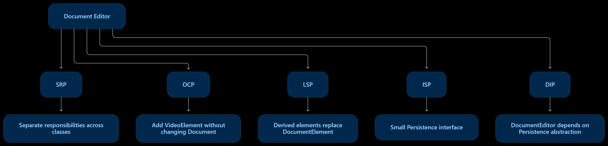

## SOLID Principles Implemented

This Document Editor demonstrates all five SOLID principles:

- **S – Single Responsibility:** Separate classes handle document elements, document management, and persistence.
- **O – Open/Closed:** New document elements and storage mechanisms can be added without modifying existing classes.
- **L – Liskov Substitution:** Derived elements (`TextElement`, `ImageElement`, etc.) can replace the base `DocumentElement`.
- **I – Interface Segregation:** The `Persistence` interface contains only the essential `save()` method.
- **D – Dependency Inversion:** `DocumentEditor` depends on the `Persistence` abstraction rather than concrete storage classes, using constructor dependency injection.

**Outcome:** A modular, extensible, and maintainable design following SOLID principles.

## Architecture Diagram

## UML Diagram

